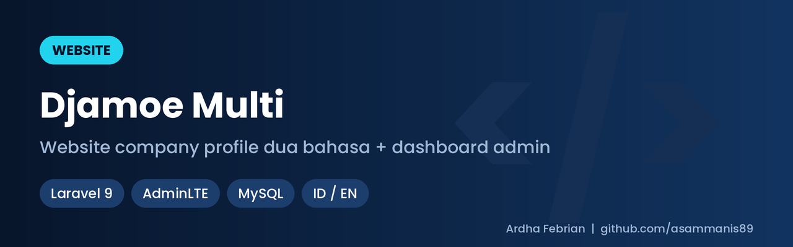
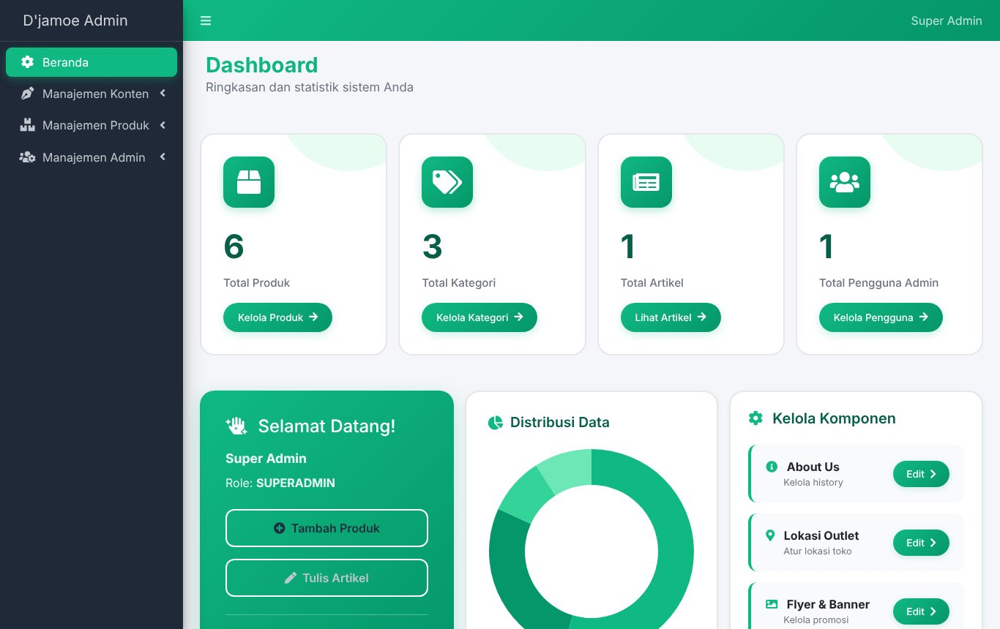
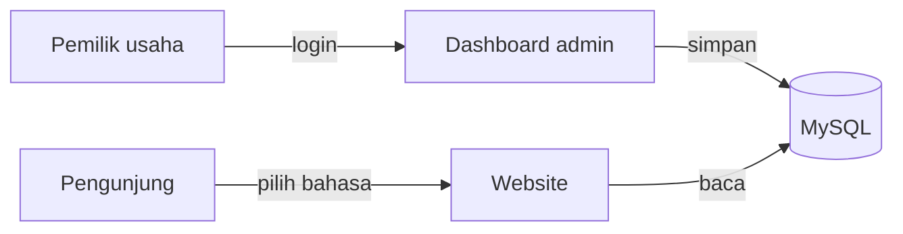

# Djamoe Multi

Website company profile dua bahasa (Indonesia dan Inggris) dengan dashboard admin, supaya pemilik usaha bisa mengganti isi website sendiri tanpa menyentuh kode.

> Repo ini berisi studi kasus, bukan kode sumber. Proyek ini dibuat untuk klien, jadi kodenya tidak dipublikasikan. Semua gambar diambil dari instalasi lokal dengan data contoh.

## Kenapa dibuat

Website company profile untuk usaha jamu ini perlu menjangkau pembaca berbahasa Indonesia dan Inggris. Website biasa menyulitkan dua hal: setiap perubahan produk atau artikel harus minta tolong developer, dan satu bahasa saja tidak cukup.

Djamoe Multi menjawab keduanya. Pengunjung bisa pindah antara bahasa Indonesia dan Inggris di tiap halaman, dan pemilik usaha mengelola produk, outlet, dan artikel sendiri lewat dashboard.

## Apa yang jadi lebih mudah

- **Ganti produk dan harga sendiri.** Tambah, ubah, atau hapus produk dari dashboard, lengkap dengan foto dan kategori.
- **Dua bahasa sekaligus.** Isi website tersedia dalam Indonesia dan Inggris, dengan pengalih bahasa di pojok menu.
- **Kabar usaha selalu segar.** Artikel dan aktivitas ditulis dari dashboard tanpa bantuan developer.
- **Pembeli tahu ke mana harus datang.** Daftar outlet tampil di website.
- **Aman dibagi ke beberapa orang.** Ada dua peran: admin mengelola konten, superadmin juga mengelola akun dan bisa menonaktifkan akun.

## Tampilan

### Website untuk pengunjung

Beranda dalam bahasa Indonesia. Menu di atas berisi Beranda, Produk, Aktivitas, Temukan Kami (outlet), dan Tentang Kami, dengan bendera di kanan untuk berganti bahasa.

Halaman yang sama setelah bendera Inggris dipilih: menu dan isi halaman ikut berganti.

Katalog produk, dikelompokkan per kategori. Klik kategori untuk melihat produknya, lalu klik produk untuk melihat detail.

### Dashboard untuk pemilik usaha

Halaman pertama setelah masuk: jumlah produk, kategori, artikel, dan pengguna, grafik sebaran data, dan pintasan untuk menambah produk atau menulis artikel. Menu di kiri dikelompokkan menjadi konten, produk, dan admin.

Daftar produk dengan foto, nama, deskripsi, kategori, harga, dan status (misalnya *Bestseller*). Tiap baris punya tombol ubah dan hapus.

## Cara kerjanya

Satu database dipakai untuk dashboard dan website. Teks yang punya dua bahasa disimpan berdampingan, jadi satu produk cukup diisi sekali dengan versi Indonesia dan Inggrisnya. Foto yang diunggah dioptimalkan otomatis supaya halaman tetap cepat dibuka.

## Teknologi

Laravel 9, AdminLTE untuk dashboard, MySQL. Pengalihan bahasa memakai paket localization dan translatable Laravel. Website dipasang di VPS Ubuntu dengan aaPanel, Nginx, dan SSL.

## Kontak

Ardha Febrian Muqorrobin, [asammanis89.github.io](https://asammanis89.github.io)
