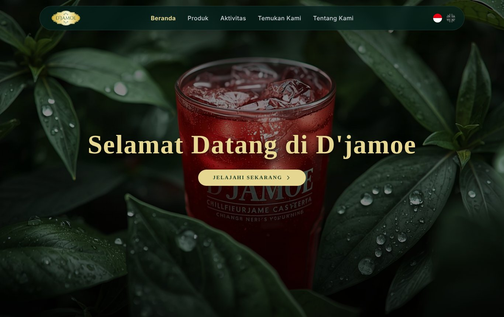
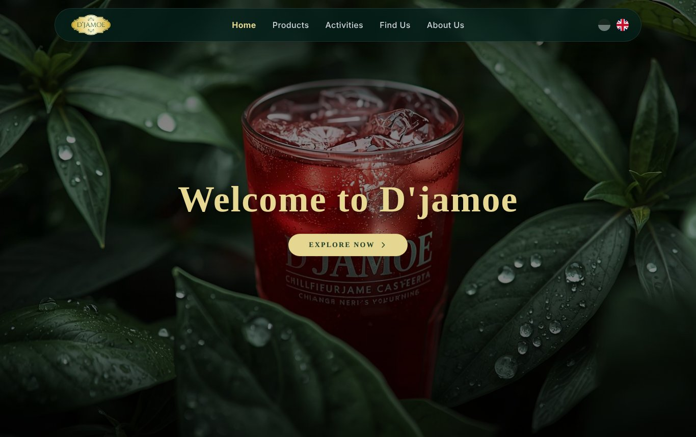
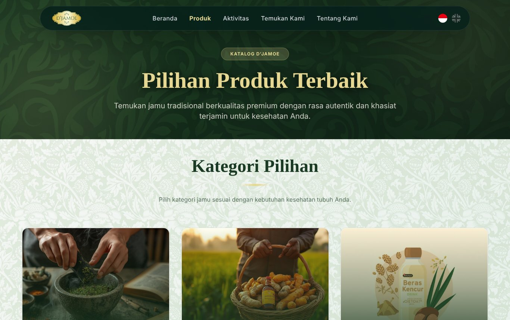
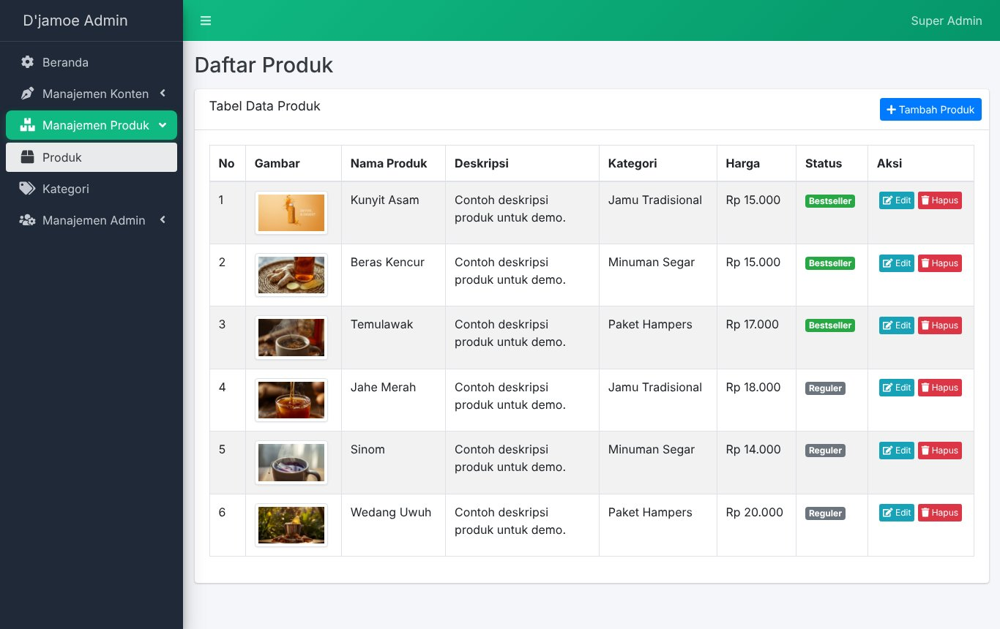

# Djamoe Multi – Website Company Profile Dwibahasa + Dashboard Admin

Website company profile **dua bahasa (Indonesia / English)** dengan **dashboard admin** untuk mengelola seluruh konten tanpa menyentuh kode. Dibangun dengan Laravel untuk klien UMKM.


*Beranda (Bahasa Indonesia)*

| English | Katalog produk |
|---|---|
|  |  |

| Dashboard admin | Kelola produk |
|---|---|
|  |  |

<sub>Screenshot dari instalasi lokal dengan data contoh.</sub>

## Fitur

- Dwibahasa ID/EN: pengalih bahasa di setiap halaman (`mcamara/laravel-localization` + `spatie/laravel-translatable`).
- **Dashboard admin** (AdminLTE) untuk mengelola: kategori, produk, lokasi/outlet, artikel/aktivitas, halaman "Tentang Kami", dan flyer.
- **Manajemen pengguna** dengan dua peran (`admin` dan `superadmin`); superadmin dapat menonaktifkan/mengaktifkan akun.
- **Halaman publik:** beranda, produk (per kategori + detail), aktivitas, outlet, tentang kami.
- **Gambar otomatis dioptimalkan** (Intervention Image).

## Tech stack

| Bagian | Teknologi |
|---|---|
| Backend | PHP ≥ 8.0.2, Laravel 9 |
| Admin UI | AdminLTE (`jeroennoten/laravel-adminlte`) |
| Bahasa | `mcamara/laravel-localization`, `spatie/laravel-translatable` |
| Database | MySQL |
| Deploy | Ubuntu VPS + aaPanel (Nginx, SSL) |

## Cara menjalankan (lokal)

```bash
git clone https://github.com/asammanis89/djamoe-multi.git
cd djamoe-multi
composer install
cp .env.example .env          # lalu isi DB_DATABASE, DB_USERNAME, DB_PASSWORD
php artisan key:generate
php artisan migrate
php artisan db:seed --class=SuperAdminSeeder
php artisan storage:link
php artisan serve
```

Buka `http://localhost:8000`, login admin di `/login`.

> Catatan: Segera **ganti password akun superadmin bawaan seeder** setelah login pertama. Jangan pernah meng-commit file `.env` maupun `storage/logs/`.

## Struktur singkat

```
app/Http/Controllers/Admin/   # CRUD dashboard admin
app/Models/                   # About, Article, Category, Flyer, Location, Product, User
routes/web.php                # rute publik (berlokalisasi) + rute admin (role-based)
resources/views/              # tampilan publik + admin
```

---

Dibuat oleh Ardha Febrian. Portofolio dan kontak: [asammanis89.github.io](https://asammanis89.github.io), WhatsApp [0857-5517-1491](https://wa.me/6285755171491).
